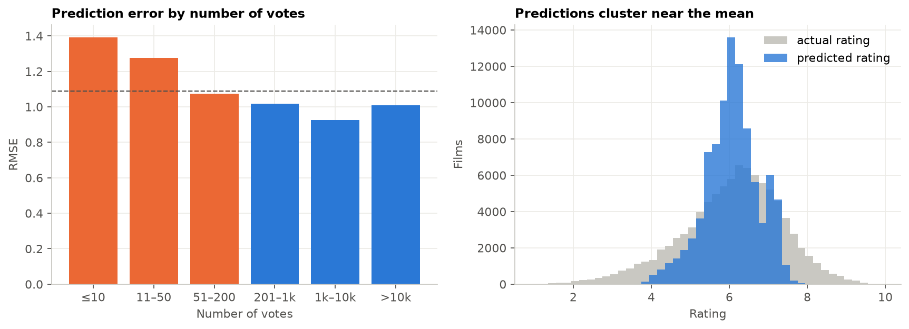
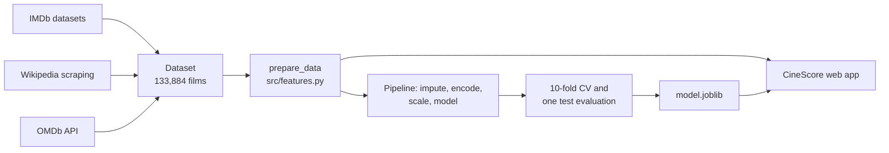
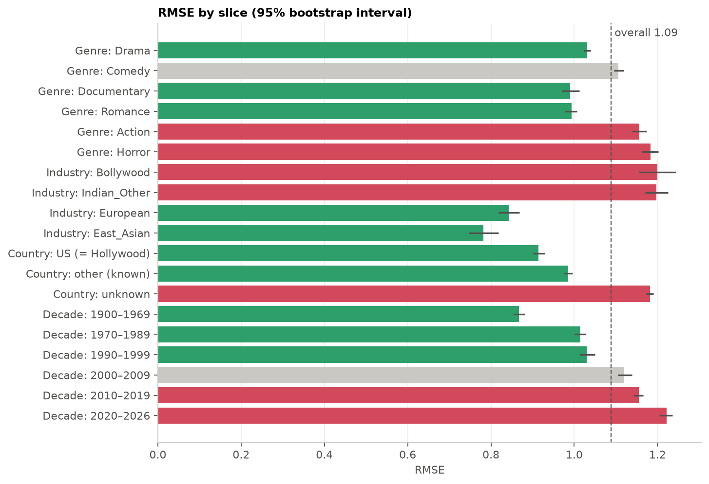

# CineScore: predicting a film's IMDb rating before release

An end-to-end machine learning project: collecting a film dataset from IMDb, Wikipedia and the OMDb API, training models that predict a film's IMDb rating from what is known before release, analysing where they fail, and serving the result in a web app.

**Live app:** [movie-rating-project-242p.onrender.com](https://movie-rating-project-242p.onrender.com/) · the free server can take up to a minute to wake up

<p align="center"></p>

## Results

| Model | 10-fold CV RMSE | Test RMSE | Test R² |
|---|---|---|---|
| Always predict the mean | 1.294 | 1.287 | 0.00 |
| Elastic Net | 1.126 | 1.122 | 0.24 |
| Decision Tree | 1.114 | 1.115 | 0.25 |
| Random Forest | 1.093 | 1.089 | 0.28 |
| **Gradient Boosting** (deployed) | **1.088** | **1.086** | **0.29** |

From title, year, runtime, genres, language and country alone, the best model cuts the error of a mean-only guess by about 16%. That is a modest R², and an honest one: most of what makes a film good or bad is not in these features.

## Key findings

| # | Finding | Evidence |
|---|---|---|
| 1 | Documentary status, runtime, age and the Horror flag drive the predictions | Permutation importance on the test set; documentaries average 7.2, horror 4.9 |
| 2 | The model shrinks toward the middle | Predictions span 3.2 to 8.8 (sd 0.69); actual ratings span 1 to 10 (sd 1.29) |
| 3 | Under-predictions come from tiny audiences | The 100 worst have a median of 24 votes; 52% are horror or action rated around 9 |
| 4 | Over-predictions are films rated far below their genre | Median 186 votes, a typical number; 28% are documentaries against 11% of all films |
| 5 | Accuracy differs across groups mostly because rating spread differs | Absolute RMSE ranges from 0.78 to 1.22, but relative RMSE (RMSE ÷ the group's rating sd) stays between 0.79 and 0.98 |



## How it works



The notebook and the app use the same feature function, so the model sees identical inputs in training and in production. All imputation, scaling and encoding happens inside the scikit-learn pipeline, fitted on training folds only. Columns that accumulate after release (`numVotes`, `BoxOffice`) are never features; `numVotes` is used only to analyse errors.

| Notebook | Contents |
|---|---|
| [01_data_collection](notebooks/01_data_collection.ipynb) | Building our share of the course dataset: the 5,000 most-voted films starting with Q or R, enriched from Wikipedia and OMDb |
| [02_rating_model](notebooks/02_rating_model.ipynb) | Features, five models, feature importance, error analysis and a fairness analysis by genre, industry, country and decade |



## What changed after review

The project was graded, and the review found a real bug: after dropping unrated films, the index was reset and then used to look titles up in the unfiltered table, so the error and fairness analyses attached the wrong title, year and genres to almost every film. A film the analysis described as rated 9.5 (The Ant Bully) is actually rated 5.8. This version fixes that and the other review points:

| Area | First version | This version |
|---|---|---|
| Row alignment | Reset index, wrong film details in two analyses | Original index kept, lookups by index, an assertion checks alignment; every case shows its IMDb ID |
| Error analysis | Hypotheses without measurement | Error by vote count, share of low-vote films among the largest errors, genre mix of the worst predictions |
| Features | 10 genres; `is_english` duplicated a one-hot column | 20 genres, 6 genre pairs, 3 title features; `is_english` removed; an ablation measures each group |
| Feature importance | Coefficients on mixed scales; little discussion | All columns standardised for the linear model, permutation importance on test data, and an explanation of why models rank features differently |
| Fairness | Absolute RMSE only; "no temporal bias" | 95% bootstrap intervals and relative RMSE; error does rise over decades, because rating spread rises |
| Models | Random Forest, 153 MB, stored with Git LFS | Gradient boosting added; slightly better and 0.6 MB |
| App | Upcoming films treated as having an unknown year | Upcoming films treated as new; 20 genres; tests |

The graded version is kept in [archive/v1](archive/v1).

## Data limitations

- Language and country are missing for about 60% of films, because no Wikipedia or OMDb page was found. Missingness partly reflects how popular a film became after release; removing these columns costs 0.011 RMSE.
- Ratings based on a handful of votes are noisy, and they are a quarter of the data.
- IMDb voters are not a representative audience, which is visible in the Indian and documentary slices.

## Repository structure

```
movie-rating-project/
├── README.md
├── requirements.txt
├── data/                 Modeling dataset (.csv.gz), our Q/R collection, and column descriptions
├── notebooks/            01 data collection · 02 rating model
├── src/features.py       Feature engineering shared by the notebook and the app
├── app/                  Flask app: api.py, templates, static files, model.joblib
├── tests/                App and feature tests
├── images/               Charts and the app screenshot
├── reports/              Data collection report (PDF)
└── archive/v1/           The graded first version
```

## How to run

```bash
pip install -r requirements.txt
pytest                                   # app and feature tests
cd app && python api.py                  # web app on http://127.0.0.1:5000
cd notebooks && jupyter lab              # notebooks (the model notebook takes about 20 minutes)
```

## Tools

Python, pandas, NumPy, scikit-learn, Matplotlib, Flask, gunicorn, Render, BeautifulSoup, OMDb API.

## Credits

Built by Nir Avrahamoff and Itamar Rot for the Data Mining and Machine Learning courses at Ariel University. Revised in 2026 by Nir Avrahamoff after the course review. Claude (Anthropic) was used for code review, debugging and the revision.
